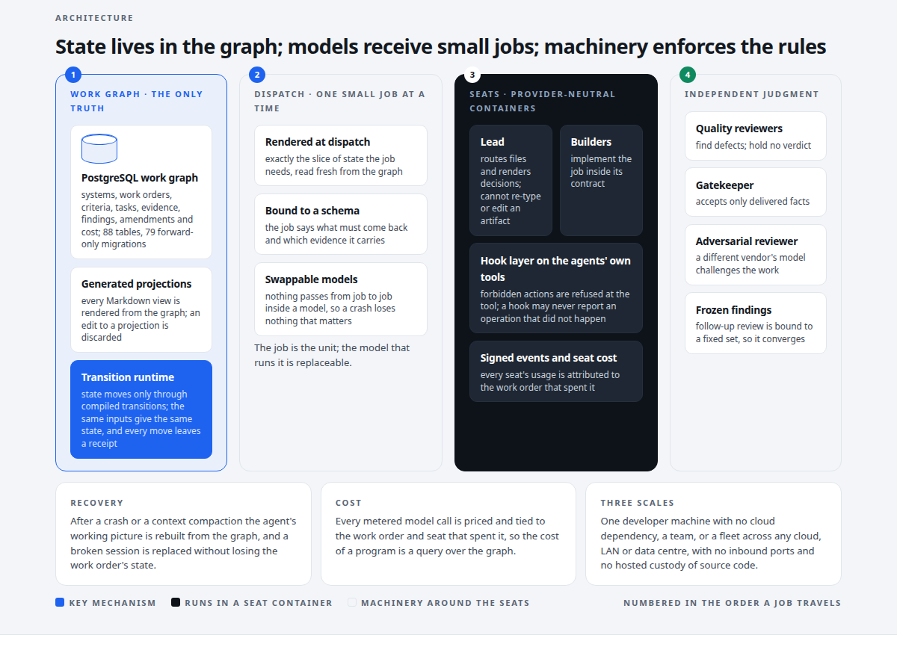
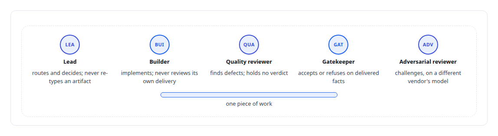
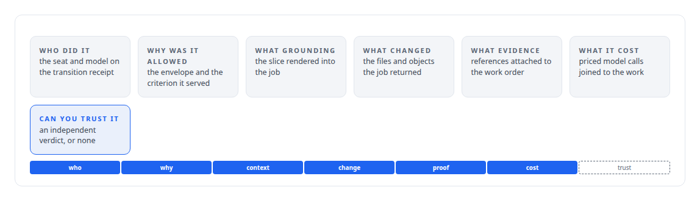
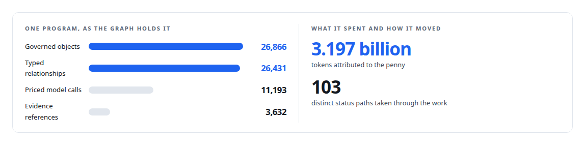
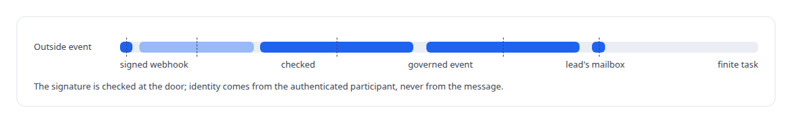

# AgentOS

**A governed work-order control plane for teams of AI engineering agents**

Canonical: https://coreyjames.ai/systems/agentos/  
Author: Corey James · Published: 2026-10-28 · Kind: system  
Technologies: [Agent Client Protocol (ACP)](https://github.com/coreyjames-ai/portfolio/tree/main/technologies/agent-client-protocol-acp) · [Bash](https://github.com/coreyjames-ai/portfolio/tree/main/technologies/bash) · [Budget enforcement and cost governance](https://github.com/coreyjames-ai/portfolio/tree/main/technologies/budget-enforcement-and-cost-governance) · [Cargo](https://github.com/coreyjames-ai/portfolio/tree/main/technologies/cargo) · [Contract-first interface design](https://github.com/coreyjames-ai/portfolio/tree/main/technologies/contract-first-interface-design) · [Cost attribution for AI work](https://github.com/coreyjames-ai/portfolio/tree/main/technologies/cost-attribution-for-ai-work) · [Credential brokering and secrets management](https://github.com/coreyjames-ai/portfolio/tree/main/technologies/credential-brokering-and-secrets-management) · [Declarative tool and agent definition](https://github.com/coreyjames-ai/portfolio/tree/main/technologies/declarative-tool-and-agent-definition) · [Docker](https://github.com/coreyjames-ai/portfolio/tree/main/technologies/docker) · [Git](https://github.com/coreyjames-ai/portfolio/tree/main/technologies/git) · [Governed AI-assisted software engineering](https://github.com/coreyjames-ai/portfolio/tree/main/technologies/governed-ai-assisted-software-engineering) · [Grafana](https://github.com/coreyjames-ai/portfolio/tree/main/technologies/grafana) · [Idempotency, exactly-once effects and crash recovery](https://github.com/coreyjames-ai/portfolio/tree/main/technologies/idempotency-exactly-once-effects-and-crash-recovery) · [Independent verification and adversarial review](https://github.com/coreyjames-ai/portfolio/tree/main/technologies/independent-verification-and-adversarial-review) · [JSON Schema](https://github.com/coreyjames-ai/portfolio/tree/main/technologies/json-schema) · [JSON Web Token (JWT)](https://github.com/coreyjames-ai/portfolio/tree/main/technologies/json-web-token-jwt) · [Large-scale refactoring with parity proof](https://github.com/coreyjames-ai/portfolio/tree/main/technologies/large-scale-refactoring-with-parity-proof) · [Linux security primitives](https://github.com/coreyjames-ai/portfolio/tree/main/technologies/linux-security-primitives) · [Model Context Protocol (MCP)](https://github.com/coreyjames-ai/portfolio/tree/main/technologies/model-context-protocol-mcp) · [Multi-agent system architecture and orchestration](https://github.com/coreyjames-ai/portfolio/tree/main/technologies/multi-agent-system-architecture-and-orchestration) · [Network egress confinement](https://github.com/coreyjames-ai/portfolio/tree/main/technologies/network-egress-confinement) · [Observability and alerting](https://github.com/coreyjames-ai/portfolio/tree/main/technologies/observability-and-alerting) · [Policy-as-code enforcement](https://github.com/coreyjames-ai/portfolio/tree/main/technologies/policy-as-code-enforcement) · [PostgreSQL](https://github.com/coreyjames-ai/portfolio/tree/main/technologies/postgresql) · [Prometheus](https://github.com/coreyjames-ai/portfolio/tree/main/technologies/prometheus) · [Python](https://github.com/coreyjames-ai/portfolio/tree/main/technologies/python) · [Redis](https://github.com/coreyjames-ai/portfolio/tree/main/technologies/redis) · [Rust](https://github.com/coreyjames-ai/portfolio/tree/main/technologies/rust) · [SQL](https://github.com/coreyjames-ai/portfolio/tree/main/technologies/sql) · [Schema and migration discipline](https://github.com/coreyjames-ai/portfolio/tree/main/technologies/schema-and-migration-discipline) · [Site reliability engineering](https://github.com/coreyjames-ai/portfolio/tree/main/technologies/site-reliability-engineering) · [State-machine design for multi-agent workflows](https://github.com/coreyjames-ai/portfolio/tree/main/technologies/state-machine-design-for-multi-agent-workflows) · [Static analysis as tests](https://github.com/coreyjames-ai/portfolio/tree/main/technologies/static-analysis-as-tests) · [Tokio](https://github.com/coreyjames-ai/portfolio/tree/main/technologies/tokio) · [Unix domain sockets](https://github.com/coreyjames-ai/portfolio/tree/main/technologies/unix-domain-sockets) · [Vendor-integration reverse engineering](https://github.com/coreyjames-ai/portfolio/tree/main/technologies/vendor-integration-reverse-engineering) · [YAML](https://github.com/coreyjames-ai/portfolio/tree/main/technologies/yaml) · [systemd](https://github.com/coreyjames-ai/portfolio/tree/main/technologies/systemd) · [tmux](https://github.com/coreyjames-ai/portfolio/tree/main/technologies/tmux)  
Skills: [cost attribution for AI work](https://github.com/coreyjames-ai/portfolio/tree/main/skills/cost-attribution-for-ai-work) · [agent orchestration](https://github.com/coreyjames-ai/portfolio/tree/main/skills/agent-orchestration) · [multi-agent governance](https://github.com/coreyjames-ai/portfolio/tree/main/skills/multi-agent-governance) · [separation of duties for AI work](https://github.com/coreyjames-ai/portfolio/tree/main/skills/separation-of-duties-for-ai-work)  


## Result

| Figure | What it measures |
| --- | --- |
| **246** | work orders governed, including the programs that built most of this site |
| **106** | hook modules across eleven lifecycle events, each a refusal |
| **31,811** | metered usage entries tied to the work that spent them |
| **< 5 s** | for another worker to resume a failed one from the graph |



## What was built

My long autonomous coding runs all failed the same way. The lead agent had to hold the operating procedure, the plan, every teammate's state and every piece of evidence in its context, and past some horizon it dropped one of them. The work then diverged quietly. I stopped treating that as a prompting problem. It is working-memory overflow, and the cure is to take the memory out of the model. AgentOS is the control plane I built on that diagnosis. The authoritative state of every engineering program lives in a PostgreSQL work graph. Each agent receives a small, freshly rendered, contract-bound job. Policy is enforced by machinery that refuses forbidden actions. Work closes only when an independent reviewer has the evidence. The agents that built AgentOS worked under it.

## The idea

A relational work graph is the only source of truth: systems, projects, work orders, acceptance criteria, tasks, evidence, review findings, amendments and cost. Every Markdown view is a generated projection of that graph, and edits to projections are discarded, because two sources of truth give drift a place to hide.

Every agent job is small, rendered at dispatch time from exactly the slice of state it needs, and bound to a schema that says what must come back. Nothing is carried from job to job inside a model's head, so models are swappable and a crash loses nothing that matters.

Rules are enforced by hooks on the agent runtime. A lead agent cannot re-type or edit an artifact; it routes files and renders decisions. A hook may never report an operation that did not happen. Those are refusals, and no prompt has to remember them.

Judgment is independent. Delivered work is checked by quality reviewers, accepted by a gatekeeper that takes only delivered facts, and challenged by an adversarial reviewer on a different vendor's model. The builder never judges its own work.



## What I built

A deterministic transition runtime advances work-order state only through compiled transitions, so the same inputs produce the same state and every move leaves a receipt.

A hook layer over the coding agents' own command-line tools turns policy into refusals.

An independent review stack separates builders, quality reviewers, the gatekeeper and the adversarial reviewer into distinct seats, with follow-up review bound to a frozen set of findings so it converges instead of re-litigating forever. The design is in [Separation of duties for AI work](https://coreyjames.ai/stories/separation-of-duties-for-ai-work).

Recovery machinery rebuilds an agent's working picture from the graph after a crash or a context compaction, and replaces a broken session without losing the work order's state.

A managed team runtime launches provider-neutral agent seats in containers through my agent runtime, with signed events and per-seat cost attribution, exposed to agents and operators as MCP tools.

Around those: cost attribution per work order; runtime observability; a helpdesk channel for defects in the harness itself; long-running standing work orders fed by inbound events; and provider adapters that run real interactive sessions of vendors' authenticated command-line tools under my own logins.

## Seven questions

An organisation that runs AI workers has to be able to answer, for any piece of work: who did it, why was it allowed, what grounding was used, what changed, what evidence exists, what did it cost, and can you trust it. AgentOS answers all seven from the work graph in seconds, because each answer is a query over rows the system wrote rather than a reconstruction after the fact. A conversation with the platform compiles into two things, a governed execution system and the governance around it: the work order is the source program and the governed execution is the compiled program.



One real program on this platform shows what that graph holds. One work order has been stood down and resumed eight times with the same state producing the same bytes. The economics of that program are in [What the work cost, to the penny](https://coreyjames.ai/stories/what-the-work-cost).



## Reacting to the world

Every team lead and seat has a mailbox, scoped to its team, with identities derived on the server from the authenticated participant. External systems register as event sources against a work order, so a signed webhook from a payments, email or social-publishing provider becomes a governed event in the owning lead's mailbox and then a finite task. A work order can keep an open-ended envelope, a standing lead that admits tasks as events arrive and brings specialists online on demand, so continuous operation is composed from the same machinery as a bounded program. The idea is [Agents that react to the world](https://coreyjames.ai/ideas/agents-that-react-to-the-world).



## The judgment in it

I made Markdown a projection on purpose, because agents and humans both like editing a plan file and that is exactly where two truths come from.


It made the lead feel slower and removed a whole class of silent corruption.

I spent weeks stabilising the control plane when a prompt-only approach would have worked for a day at a time. Several of my written rulings from that period, such as anchoring quality checks to lifecycle state and treating prose as a medium for behaviour only, are still the doctrine it runs on.

I held a platform build open for two weeks against the agents' own "done" until every close item had an independent verdict. That one is [Closed by evidence](https://coreyjames.ai/stories/closed-by-evidence).

## What it demonstrates

Control-plane and state-machine architecture, PostgreSQL schema design at scale, and the judgment to turn a recurring failure of AI agents into rules a platform enforces. The programs AgentOS has run are the proof: a native port, bit-identical in every parity cell, in under three weeks, an API platform closed all 23 of its close items under independent review, a fine-tuned model with a frozen evaluation.

## Stories

[Why long agent runs fail](https://coreyjames.ai/stories/why-long-agent-runs-fail) · [Closed by evidence](https://coreyjames.ai/stories/closed-by-evidence) · [Separation of duties for AI work](https://coreyjames.ai/stories/separation-of-duties-for-ai-work) · [Directing AI coding agents at program scale](https://coreyjames.ai/stories/directing-ai-coding-agents-at-program-scale) · [What the work cost, to the penny](https://coreyjames.ai/stories/what-the-work-cost)

## Technologies

Rust · PostgreSQL · JSON Schema · Model Context Protocol · Agent runtime hook systems · Multi-agent orchestration · Separation-of-duties review design · systemd

> I forbade the most capable agent in the system from touching deliverables.

## What was verified

Each line is a claim the canonical page supports, with the figure as the page states it.

- Agent orchestration: a PostgreSQL work graph as the only source of truth for teams of AI coding agents, each given a small contract-bound job rendered at dispatch, across 246 work orders.
- Multi-agent governance: policy turned into refusals by 106 hook modules across eleven lifecycle events on the coding agents' own command-line tools, so a lead agent cannot edit an artifact.
- Separation of duties for AI work: builders, quality reviewers, a gatekeeper and an adversarial reviewer on a different vendor's model in distinct seats; an API platform closed all 23 of its close items under independent review.
- Cost attribution for AI work: 31,811 metered usage entries tied to the work that spent them, and in one program 3.197 billion tokens attributed to the penny across 11,193 priced model calls.
- Control-plane and state-machine architecture: a 546,000-line Rust control plane whose transition runtime gives the same state from the same inputs; a failed worker is resumed from the graph in under 5 s.
- Event-driven agent systems: per-seat mailboxes scoped to the team, with signed webhooks from payments, email or social-publishing providers turned into governed events and finite tasks for the owning lead.

## Related

- [Why long agent runs fail](https://github.com/coreyjames-ai/agentos/tree/main/stories/why-long-agent-runs-fail) · https://coreyjames.ai/stories/why-long-agent-runs-fail/
- [Closed by evidence](https://github.com/coreyjames-ai/agentos/tree/main/stories/closed-by-evidence) · https://coreyjames.ai/stories/closed-by-evidence/
- [Separation of duties for AI work](https://github.com/coreyjames-ai/agentos/tree/main/stories/separation-of-duties-for-ai-work) · https://coreyjames.ai/stories/separation-of-duties-for-ai-work/
- [Directing AI coding agents at program scale](https://github.com/coreyjames-ai/agentos/tree/main/stories/directing-ai-coding-agents-at-program-scale) · https://coreyjames.ai/stories/directing-ai-coding-agents-at-program-scale/
- [What the work cost, to the penny](https://github.com/coreyjames-ai/agentos/tree/main/stories/what-the-work-cost) · https://coreyjames.ai/stories/what-the-work-cost/
- [From a conversation to a work order](https://github.com/coreyjames-ai/helix/tree/main/stories/from-a-conversation-to-a-work-order) · https://coreyjames.ai/stories/from-a-conversation-to-a-work-order/
- [Agents that react to the world](https://github.com/coreyjames-ai/portfolio/tree/main/research/ideas/agents-that-react-to-the-world) · https://coreyjames.ai/ideas/agents-that-react-to-the-world/

## Skills demonstrated

Decided at build time against every page in this system, strongest first; each links to the page that earns it.

- [cost attribution for AI work](https://github.com/coreyjames-ai/portfolio/tree/main/skills/cost-attribution-for-ai-work) · [What the work cost, to the penny](https://github.com/coreyjames-ai/agentos/tree/main/stories/what-the-work-cost)
- [C++ and native ports with parity proof](https://github.com/coreyjames-ai/portfolio/tree/main/skills/c-and-native-ports-with-parity-proof) · [Directing AI coding agents at program scale](https://github.com/coreyjames-ai/agentos/tree/main/stories/directing-ai-coding-agents-at-program-scale)
- [evidence-gated acceptance](https://github.com/coreyjames-ai/portfolio/tree/main/skills/evidence-gated-acceptance) · [Closed by evidence](https://github.com/coreyjames-ai/agentos/tree/main/stories/closed-by-evidence)
- [separation of duties for AI work](https://github.com/coreyjames-ai/portfolio/tree/main/skills/separation-of-duties-for-ai-work) · [Separation of duties for AI work](https://github.com/coreyjames-ai/agentos/tree/main/stories/separation-of-duties-for-ai-work)
- [agent orchestration](https://github.com/coreyjames-ai/portfolio/tree/main/skills/agent-orchestration) · [AgentOS](https://github.com/coreyjames-ai/agentos)
- [Rust systems engineering](https://github.com/coreyjames-ai/portfolio/tree/main/skills/rust-systems-engineering) · [Closed by evidence](https://github.com/coreyjames-ai/agentos/tree/main/stories/closed-by-evidence)
- [multi-agent governance](https://github.com/coreyjames-ai/portfolio/tree/main/skills/multi-agent-governance) · [AgentOS](https://github.com/coreyjames-ai/agentos)
- [technical leadership of agent teams](https://github.com/coreyjames-ai/portfolio/tree/main/skills/technical-leadership-of-agent-teams) · [Closed by evidence](https://github.com/coreyjames-ai/agentos/tree/main/stories/closed-by-evidence)

## Engineering stories in AgentOS (5)

| Story | Result | Figure |
| --- | --- | --- |
| [Why long agent runs fail](stories/why-long-agent-runs-fail) | Diagnosing agent drift as working-memory overflow, and building the control plane that holds the state instead | 246 |
| [Closed by evidence](stories/closed-by-evidence) | Building an API integration platform through gated AI work orders, and refusing to close it until every item had independent proof | 23 of 23 |
| [Separation of duties for AI work](stories/separation-of-duties-for-ai-work) | Independent gatekeepers, reviewers from a different vendor, and failures that stay failures | 27 |
| [Directing AI coding agents at program scale](stories/directing-ai-coding-agents-at-program-scale) | How I run engineering programs with teams of frontier and open-source models, and why evidence, not the agents, decides | 3 |
| [What the work cost, to the penny](stories/what-the-work-cost) | One real engineering program, attributed to the penny, and a cache discipline that returned four-fifths of the bill | 11,193 |

Part of [Corey James's portfolio](https://github.com/coreyjames-ai/portfolio): research, technologies, skills and the other systems. Canonical site: https://coreyjames.ai/

## Citation

Corey James. "AgentOS." coreyjames.ai, 2026. https://coreyjames.ai/systems/agentos/

```bibtex
@misc{coreyjames-agentos,
  author = {Corey James},
  title = {AgentOS},
  year = {2026},
  howpublished = {\url{https://coreyjames.ai/systems/agentos/}},
  note = {GitHub copy: https://github.com/coreyjames-ai/agentos}
}
```

Part of [AgentOS](https://github.com/coreyjames-ai/agentos) and [Corey James's portfolio](https://github.com/coreyjames-ai/portfolio) · site: https://coreyjames.ai/ · MCP server: https://coreyjames.ai/mcp · agent card: https://coreyjames.ai/.well-known/agent.json
