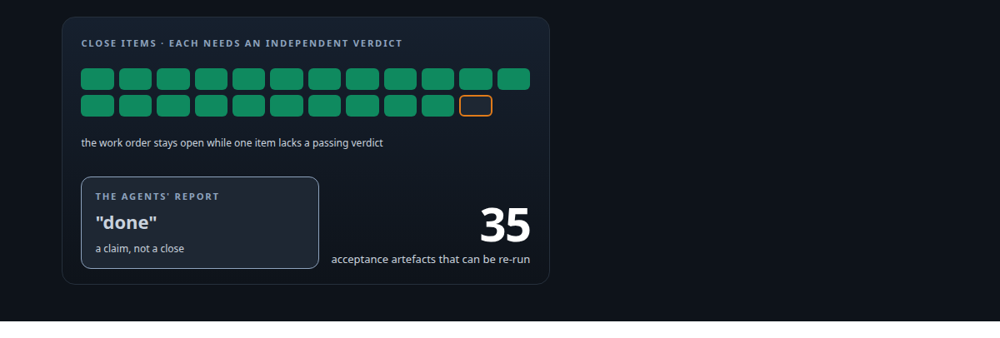
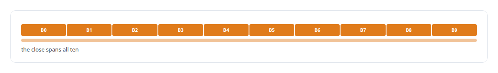
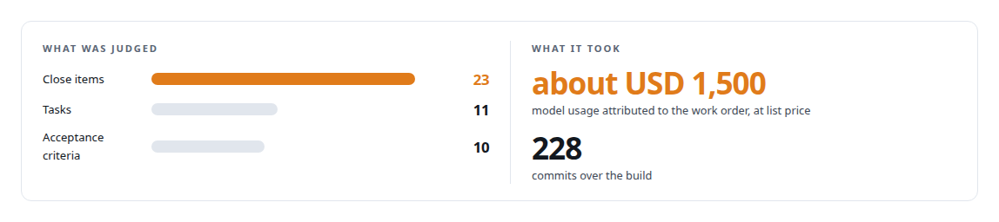

# Closed by evidence

**Building an API integration platform through gated AI work orders, and refusing to close it until every item had independent proof**

Canonical: https://coreyjames.ai/stories/closed-by-evidence/  
Author: Corey James · Published: 2026-10-28 · Kind: story  
DOI: https://doi.org/10.5281/zenodo.23735120 (this page is a chapter of the system's report)  
Systems: [AgentOS](https://github.com/coreyjames-ai/agentos) · [FAFO Core and Function Forge](https://github.com/coreyjames-ai/fafo-core)  
Technologies: [Cache synchronisation and leader election](https://github.com/coreyjames-ai/portfolio/tree/main/technologies/cache-synchronisation-and-leader-election) · [Cost attribution for AI work](https://github.com/coreyjames-ai/portfolio/tree/main/technologies/cost-attribution-for-ai-work) · [Evidence-gated API integration](https://github.com/coreyjames-ai/portfolio/tree/main/technologies/evidence-gated-api-integration) · [Evidence-gated acceptance](https://github.com/coreyjames-ai/portfolio/tree/main/technologies/evidence-gated-acceptance) · [Git](https://github.com/coreyjames-ai/portfolio/tree/main/technologies/git) · [Governed AI-assisted software engineering](https://github.com/coreyjames-ai/portfolio/tree/main/technologies/governed-ai-assisted-software-engineering) · [Independent verification and adversarial review](https://github.com/coreyjames-ai/portfolio/tree/main/technologies/independent-verification-and-adversarial-review) · [JSON Schema](https://github.com/coreyjames-ai/portfolio/tree/main/technologies/json-schema) · [OpenAPI](https://github.com/coreyjames-ai/portfolio/tree/main/technologies/openapi) · [PostgreSQL](https://github.com/coreyjames-ai/portfolio/tree/main/technologies/postgresql) · [Rust](https://github.com/coreyjames-ai/portfolio/tree/main/technologies/rust) · [Schema-driven build-time code generation](https://github.com/coreyjames-ai/portfolio/tree/main/technologies/schema-driven-build-time-code-generation)  
Skills: [evidence-gated acceptance](https://github.com/coreyjames-ai/portfolio/tree/main/skills/evidence-gated-acceptance) · [Rust systems engineering](https://github.com/coreyjames-ai/portfolio/tree/main/skills/rust-systems-engineering) · [AI-assisted engineering methodology](https://github.com/coreyjames-ai/portfolio/tree/main/skills/ai-assisted-engineering-methodology) · [tool synthesis and governed API integration](https://github.com/coreyjames-ai/portfolio/tree/main/skills/tool-synthesis-and-governed-api-integration)  



## Result

| Figure | What it measures |
| --- | --- |
| **23 of 23** | close items with a current passing verdict from an independent reviewer |
| **14 days** | from opening the work order to closing it on evidence |
| **4,297** | state transitions across 13 agent seats |

## What was built

I built an API integration platform, about 20,000 lines of Rust across five crates, almost entirely through AI agent teams working under my governance system. When the agents reported it done, I did not close it. I required a passing, current verdict from an independent reviewer on every close item, and the system closed the work order only when the last one was in. In the meantime the close machinery had bugs of its own, and I fixed those under the same rules.

## The challenge

An agent that says "done" is making a claim, and agents make that claim early and often. For a platform I intended to depend on, "done" had to mean something I could verify afterwards: every acceptance criterion with its own evidence, every close item with a reviewer's verdict, and a close that happened over all of them or not at all.

## Constraints

A mixed team, with implementation seats from two model vendors and reviewers drawn from a different family than the builders. Acceptance criteria and close items fixed before implementation started. And a young governance system whose close path had defects, closers that silently stalled and closers that ran away, which had to be fixed without lowering the bar for the work they were judging.

## My approach

I authored the reference architecture and a phased plan with gates from B0 to B9, each gate with its own acceptance script and transcript. The close rule was simple: the work order closes only when every close item has a current passing verdict from an independent reviewer. If the platform underneath could not deliver that, the platform was fixed first.



## What I built

The API integration platform itself: a Rust runtime that serves multiple integration profiles per server, with release images and a user guide.

An evidence-gated close in which the work order closes only when every close item carries an independent passing verdict.

Contract-carrying review packets, a same-day fix to the governance system so that quality-assurance and gate packets carried their own acceptance contract.

Thirty-five acceptance artefacts across the gates, each a script and a transcript that can be re-run.

Numbered design decisions for the changes that happened in flight, such as moving from one profile per server to many, so the architecture document and the code never silently diverged.

## Difficult decisions

Holding the work open. The agents' reports said done. The close items said otherwise.


Fixing the governance machinery mid-delivery, as governed work under the same rules, so the fix itself had evidence.

Writing down divergence. When the implementation needed multiple profiles per server, which the architecture document did not describe, the change became a numbered decision and the document was updated.

## Results



## Technologies used

Rust · PostgreSQL · Frontier coding models from two vendors · Shell-based conformance suites · git with witness, task and decision commits

## What this demonstrates

I let evidence decide when work is done. I can direct AI implementers through a substantial build while keeping architectural control, and when the tooling I govern with has defects, I fix the tooling rather than relax the standard.

The platform's recovery design is one of my filed inventions, described on the [research page](https://coreyjames.ai/research).

> An override on day one of a governance system is the end of that system.

## What was verified

Each line is a claim the canonical page supports, with the figure as the page states it.

- Evidence-gated acceptance: an API integration platform closed only when 23 of 23 close items carried a current passing verdict from an independent reviewer, 14 days from opening to close.
- Rust systems engineering: an API integration platform of about 20,000 lines of Rust across five crates, built almost entirely by AI agent teams under my governance system.
- Technical leadership of agent teams: 4,297 state transitions across 13 agent seats, with builders from two model vendors and reviewers from a different family.
- Re-runnable acceptance testing: a phased plan gated B0 to B9, with thirty-five acceptance artefacts, each a script and a transcript.
- Governance system reliability: defects in the close path, closers that stalled and closers that ran away, fixed mid-delivery as governed work under the same rules.

## Related

- [Why long agent runs fail](https://github.com/coreyjames-ai/agentos/tree/main/stories/why-long-agent-runs-fail) · https://coreyjames.ai/stories/why-long-agent-runs-fail/
- [Directing AI coding agents at program scale](https://github.com/coreyjames-ai/agentos/tree/main/stories/directing-ai-coding-agents-at-program-scale) · https://coreyjames.ai/stories/directing-ai-coding-agents-at-program-scale/

## Citation

Corey James. "Closed by evidence." coreyjames.ai, 2026. https://coreyjames.ai/stories/closed-by-evidence/ In: the AgentOS technical report, doi:10.5281/zenodo.23735120.

```bibtex
@misc{coreyjames-closed-by-evidence,
  author = {Corey James},
  title = {Closed by evidence},
  year = {2026},
  howpublished = {\url{https://coreyjames.ai/stories/closed-by-evidence/}},
  note = {GitHub copy: https://github.com/coreyjames-ai/agentos/tree/main/stories/closed-by-evidence},
  doi = {10.5281/zenodo.23735120}
}
```

Part of [AgentOS](https://github.com/coreyjames-ai/agentos) and [Corey James's portfolio](https://github.com/coreyjames-ai/portfolio) · site: https://coreyjames.ai/ · MCP server: https://coreyjames.ai/mcp · agent card: https://coreyjames.ai/.well-known/agent.json
