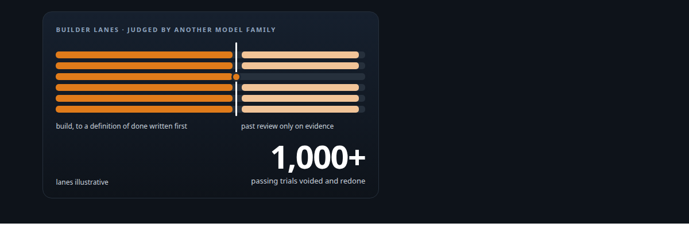
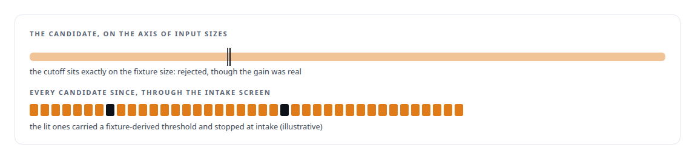
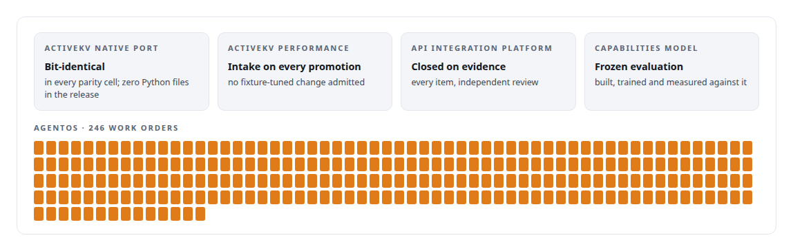

# Directing AI coding agents at program scale

**How I run engineering programs with teams of frontier and open-source models, and why evidence, not the agents, decides**

Canonical: https://coreyjames.ai/stories/directing-ai-coding-agents-at-program-scale/  
Author: Corey James · Published: 2026-10-28 · Kind: story  
DOI: https://doi.org/10.5281/zenodo.23735120 (this page is a chapter of the system's report)  
Systems: [AgentOS](https://github.com/coreyjames-ai/agentos) · [ActiveKV](https://github.com/coreyjames-ai/activekv) · [Agent Swarm](https://github.com/coreyjames-ai/agent-swarm) · [FAFO Core and Function Forge](https://github.com/coreyjames-ai/fafo-core) · [Capabilities model](https://github.com/coreyjames-ai/capabilities-model) · [FAFOHive](https://github.com/coreyjames-ai/fafohive)  
Technologies: [Git](https://github.com/coreyjames-ai/portfolio/tree/main/technologies/git) · [Governed AI-assisted software engineering](https://github.com/coreyjames-ai/portfolio/tree/main/technologies/governed-ai-assisted-software-engineering) · [Independent verification and adversarial review](https://github.com/coreyjames-ai/portfolio/tree/main/technologies/independent-verification-and-adversarial-review) · [Multi-agent system architecture and orchestration](https://github.com/coreyjames-ai/portfolio/tree/main/technologies/multi-agent-system-architecture-and-orchestration) · [tmux](https://github.com/coreyjames-ai/portfolio/tree/main/technologies/tmux)  
Skills: [C++ and native ports with parity proof](https://github.com/coreyjames-ai/portfolio/tree/main/skills/c-and-native-ports-with-parity-proof) · [evidence-gated acceptance](https://github.com/coreyjames-ai/portfolio/tree/main/skills/evidence-gated-acceptance) · [AI-assisted engineering methodology](https://github.com/coreyjames-ai/portfolio/tree/main/skills/ai-assisted-engineering-methodology) · [technical leadership of agent teams](https://github.com/coreyjames-ai/portfolio/tree/main/skills/technical-leadership-of-agent-teams)  



## Result

| Figure | What it measures |
| --- | --- |
| **3** | weeks at most for a native port, bit-identical in every parity cell |
| **24** | performance promotions in four days, each through an intake review |
| **23 of 23** | close items closed under independent review |

## What was built

Most of the code behind the systems on this site was written by AI coding agents. The interesting part is that the programs finished, passed independent review, and can be trusted: a native port with bit-identical output, an API platform closed under independent review, a fine-tuned model with a frozen evaluation. That happens because I run agent teams the way an architect runs an engineering organisation. I write the rules, I separate the builders from the judges, and I let evidence decide.

## The challenge

AI coding agents are fast, tireless and confidently wrong. Left to themselves they over-claim completion, drift from the plan as context fills, and optimise for whatever metric is in front of them, including gaming a benchmark fixture. Human attention is the one resource that does not scale. The question for anyone building serious systems this way is how you know what they built is what you asked for, and correct.

## Constraints

Mixed models, by design. The teams use frontier models and open-source models together, because different families have different failure modes and that is useful if you arrange for them to check each other. One human, so review had to be structural. And truth over throughput: a fast program that produces unverifiable results is worth nothing.

## My approach

Four rules, applied to every program.

I write the acceptance rules before the work starts: a definition of done, an intake review standard, a certification procedure, and a promotion procedure for performance changes. When a new situation produces a ruling, the ruling is written down and becomes standing doctrine.

Builders and judges are different agents from different model families. The model that wrote a change does not review it. Quality assurance, a gatekeeper and an adversarial reviewer are separate seats.

Evidence decides. A lane's claim that it is done is a claim. The system closes work only on evidence that exists and checks out.

The machinery enforces the rules. My governance system refuses forbidden actions and keeps the authoritative state outside any model's context, so compaction and crashes cannot lose it.

## What I built

The programs below all ran this way, and most have their own story.

The ActiveKV native port and performance program: a bit-identical port, then a run of performance promotions, each through an intake review that rejects fixture-tuned gains.

An API integration platform, closed by the system itself on every close item under independent review after I held it open against the agents' own "done".

The capabilities model: data, training, a custom decoder, serving and a frozen evaluation, built under a single work order with an independent quality seat.

Three social-platform integrations built in about two days against a written standard that every tool must satisfy before it is used.

Agent Swarm phases with gatekeepers who never implemented what they judged, and a phase held at conditional pass on two failed gates.

AgentOS itself, the control plane that makes the above routine, built by agents working under it.

## Difficult decisions

Voiding passing work. During the port, over a thousand passing trials and over a hundred engineering notes were voided when I found that a native component had been registered after the system had already chosen its code path. Everything downstream was redone with proof of binding order.


Rejecting a real gain. One performance candidate produced a genuine improvement. Its cutoff happened to match the size of the test fixture. I rejected it and wrote the rule that fixture-derived thresholds never enter the product. That rule runs as an intake screen on every candidate.



Holding work open. When an agent team reported the API platform done, I required the independent close evidence instead. It took longer and it closed clean.

## Results



## Technologies used

Frontier coding models · Open-source models · git at program scale · Work-order governance · Separation-of-duties review · Written definitions of done · Intake and promotion procedures

## What this demonstrates

I lead AI-assisted engineering as an architect and director. I set the architecture, write the rules, review the evidence and own the result. The systems on this site are the proof that this way of working produces systems that hold up under independent review.

> The tests were real, and they were testing the wrong thing.

## What was verified

Each line is a claim the canonical page supports, with the figure as the page states it.

- Technical leadership of agent teams: engineering programs run with teams of frontier and open-source models under written rules, with builders and judges on different model families.
- C++ and native ports with parity proof: a native port completed in at most 3 weeks, bit-identical in every parity cell.
- Performance engineering governance: 24 performance promotions in four days, each through an intake review that rejects fixture-tuned gains.
- Evidence-gated acceptance: an API platform held open against the agents' own done and closed on 23 of 23 close items under independent review.
- Integrity of results: over a thousand passing trials voided when a native component was found registered after the code path was chosen, and the work redone with proof of binding order.

## Related

- [Why long agent runs fail](https://github.com/coreyjames-ai/agentos/tree/main/stories/why-long-agent-runs-fail) · https://coreyjames.ai/stories/why-long-agent-runs-fail/
- [Closed by evidence](https://github.com/coreyjames-ai/agentos/tree/main/stories/closed-by-evidence) · https://coreyjames.ai/stories/closed-by-evidence/
- [Separation of duties for AI work](https://github.com/coreyjames-ai/agentos/tree/main/stories/separation-of-duties-for-ai-work) · https://coreyjames.ai/stories/separation-of-duties-for-ai-work/
- [Rewriting an engine extension without changing a token](https://github.com/coreyjames-ai/activekv/tree/main/stories/rewriting-an-engine-extension-without-changing-a-token) · https://coreyjames.ai/stories/rewriting-an-engine-extension-without-changing-a-token/
- [Proving a rewrite is the same system](https://github.com/coreyjames-ai/activekv/tree/main/stories/proving-a-rewrite-is-the-same-system) · https://coreyjames.ai/stories/proving-a-rewrite-is-the-same-system/

## Citation

Corey James. "Directing AI coding agents at program scale." coreyjames.ai, 2026. https://coreyjames.ai/stories/directing-ai-coding-agents-at-program-scale/ In: the AgentOS technical report, doi:10.5281/zenodo.23735120.

```bibtex
@misc{coreyjames-directing-ai-coding-agents-at-program-scale,
  author = {Corey James},
  title = {Directing AI coding agents at program scale},
  year = {2026},
  howpublished = {\url{https://coreyjames.ai/stories/directing-ai-coding-agents-at-program-scale/}},
  note = {GitHub copy: https://github.com/coreyjames-ai/agentos/tree/main/stories/directing-ai-coding-agents-at-program-scale},
  doi = {10.5281/zenodo.23735120}
}
```

Part of [AgentOS](https://github.com/coreyjames-ai/agentos) and [Corey James's portfolio](https://github.com/coreyjames-ai/portfolio) · site: https://coreyjames.ai/ · MCP server: https://coreyjames.ai/mcp · agent card: https://coreyjames.ai/.well-known/agent.json
