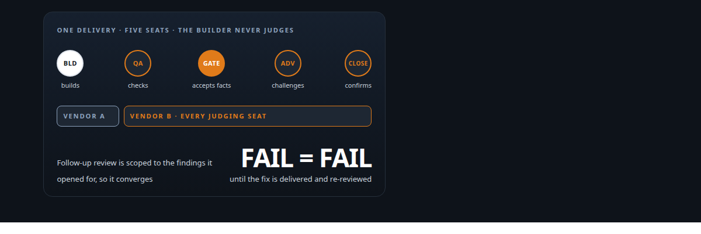
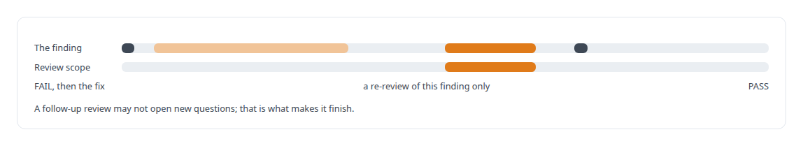
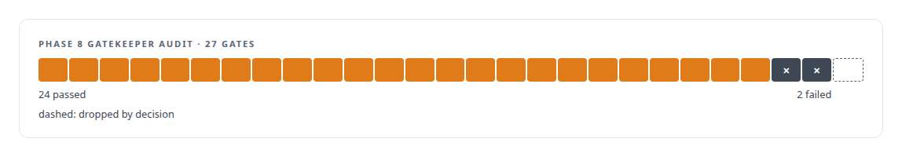

# Separation of duties for AI work

**Independent gatekeepers, reviewers from a different vendor, and failures that stay failures**

Canonical: https://coreyjames.ai/stories/separation-of-duties-for-ai-work/  
Author: Corey James · Published: 2026-10-28 · Kind: story  
Systems: [AgentOS](https://github.com/coreyjames-ai/agentos) · [Agent Swarm](https://github.com/coreyjames-ai/agent-swarm)  
Technologies: [Evidence-gated acceptance](https://github.com/coreyjames-ai/portfolio/tree/main/technologies/evidence-gated-acceptance) · [Governed AI-assisted software engineering](https://github.com/coreyjames-ai/portfolio/tree/main/technologies/governed-ai-assisted-software-engineering) · [Independent verification and adversarial review](https://github.com/coreyjames-ai/portfolio/tree/main/technologies/independent-verification-and-adversarial-review) · [JSON Schema](https://github.com/coreyjames-ai/portfolio/tree/main/technologies/json-schema) · [Model Context Protocol (MCP)](https://github.com/coreyjames-ai/portfolio/tree/main/technologies/model-context-protocol-mcp) · [Multi-agent system architecture and orchestration](https://github.com/coreyjames-ai/portfolio/tree/main/technologies/multi-agent-system-architecture-and-orchestration) · [PostgreSQL](https://github.com/coreyjames-ai/portfolio/tree/main/technologies/postgresql) · [State-machine design for multi-agent workflows](https://github.com/coreyjames-ai/portfolio/tree/main/technologies/state-machine-design-for-multi-agent-workflows) · [tmux](https://github.com/coreyjames-ai/portfolio/tree/main/technologies/tmux)  
Skills: [separation of duties for AI work](https://github.com/coreyjames-ai/portfolio/tree/main/skills/separation-of-duties-for-ai-work) · [evidence-gated acceptance](https://github.com/coreyjames-ai/portfolio/tree/main/skills/evidence-gated-acceptance) · [multi-agent governance](https://github.com/coreyjames-ai/portfolio/tree/main/skills/multi-agent-governance) · [agent orchestration](https://github.com/coreyjames-ai/portfolio/tree/main/skills/agent-orchestration)  



## Result

| Figure | What it measures |
| --- | --- |
| **27** | gates audited in the eighth phase of the swarm build |
| **2** | failed gates kept as failures, not narrowed away |
| **1** | unrelated gate dropped by explicit decision |

## What was built

AI reviewers have two failure modes. Left alone they re-litigate forever. Drawn from the same model as the builder they share its blind spots and pass its mistakes. I applied the principle regulated industries use: the people who build do not judge, the judges are independent, and a failure stays a failure until it is fixed. In my system the builders, the quality reviewers, the gatekeeper and the adversarial reviewer are separate agents, the reviewers run on a different vendor's models from the builders, and a phase with two failed gates is held at a conditional pass with two failures.

## The challenge

Agent teams report success. They are built to complete tasks and they complete the task of saying so. For the output to be trustworthy, something independent has to check it, and that something has to finish: an AI reviewer with no bounds finds a new concern on every pass. The human, me, had to remain the only override, and the override had to be rare enough to mean something.

## Constraints

Review must be genuinely separate from building and must converge. The human can narrow or drop a criterion; nobody else can. Criteria that are wrong get dropped explicitly, by decision.

## My approach

Separate seats with separate jobs. Builders deliver. Quality reviewers check against the acceptance criteria. A gatekeeper accepts only delivered facts, never promises. An adversarial reviewer on a different vendor's model looks for what the others missed. A final closer confirms nothing in the close evidence is missing. Follow-up review is scoped to the findings it was opened for so it converges, and a FAIL remains a FAIL until the fix is delivered and re-reviewed.



## What I built

Governed follow-up review, scoped to the findings it was opened for.

Pressure checks and envelope audits that confirm a delivery stayed inside what was authorised.

A written review doctrine that the reviewer seats operate under.

The origin practice: gatekeeper reports written by agents who had never implemented what they judged, and closure packets that carried every gate's verdict.

## Difficult decisions

No new role for testing. When the team proposed a dedicated testing role, I ruled that testing is a developer activity that produces evidence.


Scrubbing checksums from reviewer packets. Reviewers were matching hashes instead of reading content. I removed the hashes so they had to reason about what was delivered.

Holding a phase at conditional pass. The eighth phase of the swarm build audited 27 gates. Two failed: workspaces were not archived, and a working document contained credential-shaped values. The tempting fix was to narrow the criteria. I set the conditional pass with both failures on it, dropped one unrelated gate by explicit decision, and had the archival tooling built afterwards.



## Results

Envelope review was delivered end to end through managed reviewer seats, with reviewers on different vendors' models from the builders.

## Technologies used

PostgreSQL · JSON Schema · Frontier coding models from more than one vendor · Model Context Protocol · Review doctrine as a written artefact

## What this demonstrates

Quality-engineering separation of duties applied to AI-produced work, and integrity in acceptance: the failures stay because they happened.

> Adding a role would have let builders stop testing.

## What was verified

Each line is a claim the canonical page supports, with the figure as the page states it.

- Separation of duties for AI work: builders, quality reviewers, a gatekeeper and an adversarial reviewer as separate agents, with the reviewers on a different vendor's models from the builders.
- Evidence-gated acceptance: a phase audited against 27 gates held at a conditional pass, its 2 failed gates kept as failures and 1 unrelated gate dropped by explicit decision rather than by narrowing the criteria.
- Multi-agent governance: follow-up review scoped to the findings it was opened for so AI review converges, and a FAIL stays a FAIL until the fix is delivered and re-reviewed.
- Quality engineering for AI-produced work: checksums scrubbed from reviewer packets so reviewers reasoned about delivered content, and testing kept a developer activity that produces evidence rather than a new role.

## Related

- [Why long agent runs fail](https://github.com/coreyjames-ai/agentos/tree/main/stories/why-long-agent-runs-fail) · https://coreyjames.ai/stories/why-long-agent-runs-fail/
- [Closed by evidence](https://github.com/coreyjames-ai/agentos/tree/main/stories/closed-by-evidence) · https://coreyjames.ai/stories/closed-by-evidence/
- [Directing AI coding agents at program scale](https://github.com/coreyjames-ai/agentos/tree/main/stories/directing-ai-coding-agents-at-program-scale) · https://coreyjames.ai/stories/directing-ai-coding-agents-at-program-scale/

## Citation

Corey James. "Separation of duties for AI work." coreyjames.ai, 2026. https://coreyjames.ai/stories/separation-of-duties-for-ai-work/

```bibtex
@misc{coreyjames-separation-of-duties-for-ai-work,
  author = {Corey James},
  title = {Separation of duties for AI work},
  year = {2026},
  howpublished = {\url{https://coreyjames.ai/stories/separation-of-duties-for-ai-work/}},
  note = {GitHub copy: https://github.com/coreyjames-ai/agentos/tree/main/stories/separation-of-duties-for-ai-work}
}
```

Part of [AgentOS](https://github.com/coreyjames-ai/agentos) and [Corey James's portfolio](https://github.com/coreyjames-ai/portfolio) · site: https://coreyjames.ai/ · MCP server: https://coreyjames.ai/mcp · agent card: https://coreyjames.ai/.well-known/agent.json
