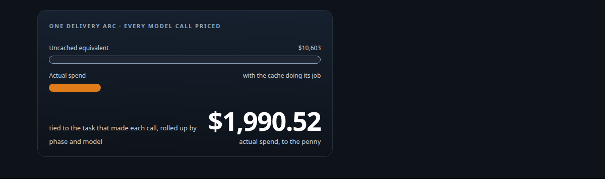
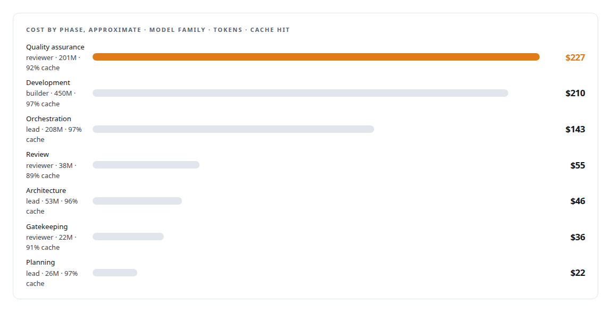
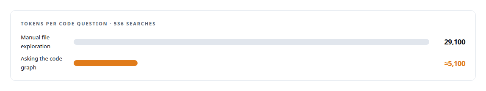
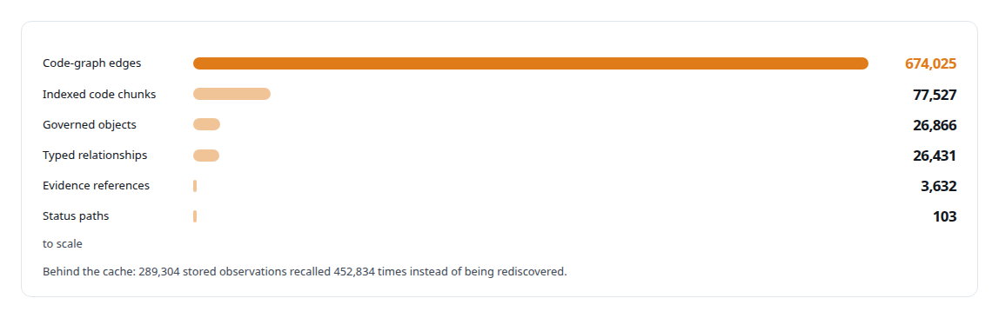

# What the work cost, to the penny

**One real engineering program, attributed to the penny, and a cache discipline that returned four-fifths of the bill**

Canonical: https://coreyjames.ai/stories/what-the-work-cost/  
Author: Corey James · Published: 2026-10-28 · Kind: story  
Systems: [AgentOS](https://github.com/coreyjames-ai/agentos) · [FAFOHive](https://github.com/coreyjames-ai/fafohive)  
Technologies: [Budget enforcement and cost governance](https://github.com/coreyjames-ai/portfolio/tree/main/technologies/budget-enforcement-and-cost-governance) · [Context engineering and persistent agent memory](https://github.com/coreyjames-ai/portfolio/tree/main/technologies/context-engineering-and-persistent-agent-memory) · [Cost attribution for AI work](https://github.com/coreyjames-ai/portfolio/tree/main/technologies/cost-attribution-for-ai-work) · [PostgreSQL](https://github.com/coreyjames-ai/portfolio/tree/main/technologies/postgresql)  
Skills: [cost attribution for AI work](https://github.com/coreyjames-ai/portfolio/tree/main/skills/cost-attribution-for-ai-work) · [AI-assisted engineering methodology](https://github.com/coreyjames-ai/portfolio/tree/main/skills/ai-assisted-engineering-methodology)  



## Result

| Figure | What it measures |
| --- | --- |
| **11,193** | priced model calls, each tied to its task |
| **3.197 B** | tokens attributed across the arc |
| **94.5%** | overall cache hit rate |
| **36,515** | governed state transitions along the way |

## What was built

Most platforms report a vendor invoice. I wanted to know what the work cost: every model call priced, tied to the task that made it, rolled up by phase and by model, with the cache's contribution counted. I have that answer for one real delivery arc under my governance platform, down to about five and a half cents per governed step.

## Why cost is a field

In AgentOS every model call is metered against the work order and task that made it, so cost attaches to the work rather than to a month. Budgets are part of the contract: a work order carries a spend ceiling, and exhausting it stops the work. Cheap is the default and expensive is a choice, because a role contract names its model and reasoning effort as data, and the orchestration, architecture and planning seats use a heavier model than the development seats on purpose.

## By phase and model



Cache discipline is the difference between a program that is affordable to run for weeks and one that is not. The cache is not an accident: jobs are rendered from the work graph with stable prefixes, grounding bundles are reused, and stored observations were recalled across the program instead of being rediscovered.

## Cheaper and smarter the longer it runs

The memory service is the other half of the economics.




## What the graph holds

Every cost entry is a node in the program's work graph, so the question "what did this cost and why" is a query, not an audit.



## What this demonstrates

Economics as an engineering discipline: attribution designed into the control plane, budgets enforced as contracts, and a memory layer that makes the second week cheaper than the first.

> A model that remembers beats a model that recalls, and it costs less too.

## What was verified

Each line is a claim the canonical page supports, with the figure as the page states it.

- Cost attribution for AI work: 11,193 priced model calls tied to the tasks that made them, 3.197 B tokens attributed across one delivery arc, about five and a half cents per governed step.
- LLM cost optimisation with prompt caching: a 94.5% overall cache hit rate from stable rendered prefixes and reused grounding, returning four-fifths of the bill.
- Budget enforcement for AI agents: a spend ceiling on every work order that stops the work when exhausted, with model and reasoning effort named per role as data.
- Code intelligence economics: asking the code graph cost about 5,100 tokens per code question against 29,100 for manual exploration, across 536 recorded searches.
- Memory for AI agents: 289,304 stored observations recalled 452,834 times instead of being rediscovered, along 36,515 governed state transitions.

## Related

- [Why long agent runs fail](https://github.com/coreyjames-ai/agentos/tree/main/stories/why-long-agent-runs-fail) · https://coreyjames.ai/stories/why-long-agent-runs-fail/
- [Closed by evidence](https://github.com/coreyjames-ai/agentos/tree/main/stories/closed-by-evidence) · https://coreyjames.ai/stories/closed-by-evidence/
- [Directing AI coding agents at program scale](https://github.com/coreyjames-ai/agentos/tree/main/stories/directing-ai-coding-agents-at-program-scale) · https://coreyjames.ai/stories/directing-ai-coding-agents-at-program-scale/

## Citation

Corey James. "What the work cost, to the penny." coreyjames.ai, 2026. https://coreyjames.ai/stories/what-the-work-cost/

```bibtex
@misc{coreyjames-what-the-work-cost,
  author = {Corey James},
  title = {What the work cost, to the penny},
  year = {2026},
  howpublished = {\url{https://coreyjames.ai/stories/what-the-work-cost/}},
  note = {GitHub copy: https://github.com/coreyjames-ai/agentos/tree/main/stories/what-the-work-cost}
}
```

Part of [AgentOS](https://github.com/coreyjames-ai/agentos) and [Corey James's portfolio](https://github.com/coreyjames-ai/portfolio) · site: https://coreyjames.ai/ · MCP server: https://coreyjames.ai/mcp · agent card: https://coreyjames.ai/.well-known/agent.json
