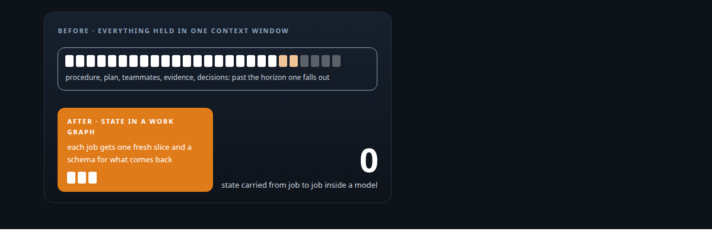
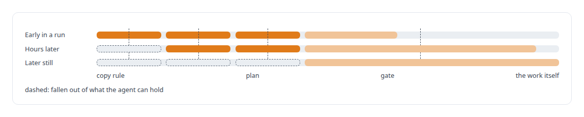
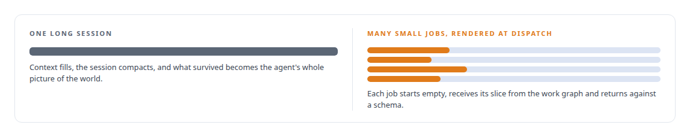

# Why long agent runs fail

**Diagnosing agent drift as working-memory overflow, and building the control plane that holds the state instead**

Canonical: https://coreyjames.ai/stories/why-long-agent-runs-fail/  
Author: Corey James · Published: 2026-10-28 · Kind: story  
Systems: [AgentOS](https://github.com/coreyjames-ai/agentos)  
Technologies: [Context engineering and persistent agent memory](https://github.com/coreyjames-ai/portfolio/tree/main/technologies/context-engineering-and-persistent-agent-memory) · [Contract-first interface design](https://github.com/coreyjames-ai/portfolio/tree/main/technologies/contract-first-interface-design) · [Governed AI-assisted software engineering](https://github.com/coreyjames-ai/portfolio/tree/main/technologies/governed-ai-assisted-software-engineering) · [Idempotency, exactly-once effects and crash recovery](https://github.com/coreyjames-ai/portfolio/tree/main/technologies/idempotency-exactly-once-effects-and-crash-recovery) · [JSON Schema](https://github.com/coreyjames-ai/portfolio/tree/main/technologies/json-schema) · [Model Context Protocol (MCP)](https://github.com/coreyjames-ai/portfolio/tree/main/technologies/model-context-protocol-mcp) · [Multi-agent system architecture and orchestration](https://github.com/coreyjames-ai/portfolio/tree/main/technologies/multi-agent-system-architecture-and-orchestration) · [Policy-as-code enforcement](https://github.com/coreyjames-ai/portfolio/tree/main/technologies/policy-as-code-enforcement) · [PostgreSQL](https://github.com/coreyjames-ai/portfolio/tree/main/technologies/postgresql) · [Rust](https://github.com/coreyjames-ai/portfolio/tree/main/technologies/rust) · [SQL](https://github.com/coreyjames-ai/portfolio/tree/main/technologies/sql) · [Schema and migration discipline](https://github.com/coreyjames-ai/portfolio/tree/main/technologies/schema-and-migration-discipline) · [State-machine design for multi-agent workflows](https://github.com/coreyjames-ai/portfolio/tree/main/technologies/state-machine-design-for-multi-agent-workflows) · [systemd](https://github.com/coreyjames-ai/portfolio/tree/main/technologies/systemd)  
Skills: [agent orchestration](https://github.com/coreyjames-ai/portfolio/tree/main/skills/agent-orchestration) · [cost attribution for AI work](https://github.com/coreyjames-ai/portfolio/tree/main/skills/cost-attribution-for-ai-work) · [multi-agent governance](https://github.com/coreyjames-ai/portfolio/tree/main/skills/multi-agent-governance) · [Rust systems engineering](https://github.com/coreyjames-ai/portfolio/tree/main/skills/rust-systems-engineering)  



## Result

| Figure | What it measures |
| --- | --- |
| **246** | work orders run under the control plane |
| **45,097** | state transitions, each with a receipt |
| **31,811** | metered usage entries tied to the work that spent them |

## What was built

Every long autonomous coding run I launched failed the same way. Somewhere past a horizon the lead agent lost a rule, a plan step or a teammate's state, and the work quietly diverged from what had been agreed. The common response is a longer, sterner prompt. I had done that, and it bought a few more hours before the same drift returned. So I named the failure for what it is, working-memory overflow, and built the control plane that follows from that name. AgentOS moves the state out of the model and into a database, makes every job small and freshly rendered, and enforces the rules with machinery.

## The challenge

An AI coding agent given a day-long task has to hold the operating procedure, the plan, what each teammate is doing, what evidence has come back and what was decided an hour ago. Its context window is finite, and when the session is compacted or restarted its picture of the world is whatever survived. The failures look like carelessness. An agent re-types an artifact it should have copied. It completes a task against a stale plan. It declares work done because it no longer remembers the acceptance rule.



## Constraints

The models were the models. I was working through vendors' own command-line tools and sessions with the context limits they come with. Work had to survive crashes and compaction, so the state could not live only in a session. I was the only human, so the system had to run overnight without me and bring back proof. And the agent that did the work could not be the agent that judged it.

## My approach

State lives in a database. The authoritative copy of every work order, task, decision, piece of evidence and cost is a PostgreSQL work graph. Markdown views are generated projections of that graph.


Every job is small, freshly rendered and contract-bound. An agent receives exactly the slice of state its job needs, rendered at dispatch time, with a schema that says what must come back. Nothing is carried from job to job inside a model's head.



Rules are enforced. Hooks on the agent runtime refuse actions the policy forbids. A lead agent cannot re-type or edit an artifact; it routes files and renders decisions.

Judgment is independent. Delivered work is judged by reviewer agents that did not build it, and the system closes a work order only on evidence that checks out.

## What I built

AgentOS is a Rust control plane over PostgreSQL: about 546,000 lines across nineteen crates, 79 forward-only migrations, 88 tables.

A deterministic transition runtime, so the same inputs produce the same state and every move leaves a receipt.

Signed, replay-safe event ingestion from the agents and from outside systems, with fail-closed provenance on transcripts and usage.

A hook layer over the coding agent, 106 modules across eleven lifecycle events, that turns policy into refusals.

An independent review stack with cross-vendor reviewers, so the model that wrote the code is never the model that passes it.

Recovery machinery that rebuilds an agent's working picture from the work graph after a crash or a context compaction.

Per-work-order cost attribution, so every token spent is tied to the work it bought.

## Difficult decisions

I made Markdown a projection. Agents and humans both like editing a plan file. The file is rendered from the database and any edit to it is discarded, because the moment two sources of truth exist, drift has a place to hide.

I forbade the lead from touching artifacts. The most capable agent in the system cannot re-type, summarise or edit any deliverable. That removed a whole class of silent corruption and made the lead feel slower.

I took a stabilisation period. Early on the system was not yet trustworthy, and the tempting path was a prompt-only approach that worked a day at a time. I spent the weeks on the control plane instead. Several of my written rulings from that period, such as anchoring quality checks to lifecycle state and insisting that work start only when its inputs are in place, are still the doctrine it runs on.

## Results

The programs it has run include a full Python-to-C++ port of an inference memory layer, an API integration platform closed on all 23 of its close items under independent review, and the fine-tuning of a tool-discovery model. Runs of a day or more without human intervention are routine.

## Technologies used

Rust · PostgreSQL · JSON Schema contracts · Model Context Protocol · Agent runtime hook systems · Multi-agent orchestration · Separation-of-duties review design · systemd

## What this demonstrates

I diagnose before I design. The architecture of AgentOS is the consequence of one precise statement about why the previous approach failed. And I will spend weeks on an unglamorous control plane when the alternative is a system that looks fine for a day.

> If drift is memory overflow, the cure is less to remember.

## What was verified

Each line is a claim the canonical page supports, with the figure as the page states it.

- Agent orchestration: a PostgreSQL work graph holds every work order, task, decision and cost, and each agent gets a small contract-bound job rendered at dispatch, across 246 work orders.
- Diagnosing LLM agent drift: long-run failures named as working-memory overflow and answered by moving state out of the model, with recovery that rebuilds an agent's picture from the graph after a crash or compaction.
- Multi-agent governance: 106 hook modules across eleven lifecycle events turn policy into refusals, so the lead agent cannot re-type or edit an artifact.
- Control-plane and state-machine architecture: a Rust control plane of about 546,000 lines with 79 forward-only migrations, where 45,097 state transitions each left a receipt.
- Cost attribution for AI work: 31,811 metered usage entries tied to the work that spent them.

## Related

- [Closed by evidence](https://github.com/coreyjames-ai/agentos/tree/main/stories/closed-by-evidence) · https://coreyjames.ai/stories/closed-by-evidence/
- [Separation of duties for AI work](https://github.com/coreyjames-ai/agentos/tree/main/stories/separation-of-duties-for-ai-work) · https://coreyjames.ai/stories/separation-of-duties-for-ai-work/
- [Directing AI coding agents at program scale](https://github.com/coreyjames-ai/agentos/tree/main/stories/directing-ai-coding-agents-at-program-scale) · https://coreyjames.ai/stories/directing-ai-coding-agents-at-program-scale/

## Citation

Corey James. "Why long agent runs fail." coreyjames.ai, 2026. https://coreyjames.ai/stories/why-long-agent-runs-fail/

```bibtex
@misc{coreyjames-why-long-agent-runs-fail,
  author = {Corey James},
  title = {Why long agent runs fail},
  year = {2026},
  howpublished = {\url{https://coreyjames.ai/stories/why-long-agent-runs-fail/}},
  note = {GitHub copy: https://github.com/coreyjames-ai/agentos/tree/main/stories/why-long-agent-runs-fail}
}
```

Part of [AgentOS](https://github.com/coreyjames-ai/agentos) and [Corey James's portfolio](https://github.com/coreyjames-ai/portfolio) · site: https://coreyjames.ai/ · MCP server: https://coreyjames.ai/mcp · agent card: https://coreyjames.ai/.well-known/agent.json
